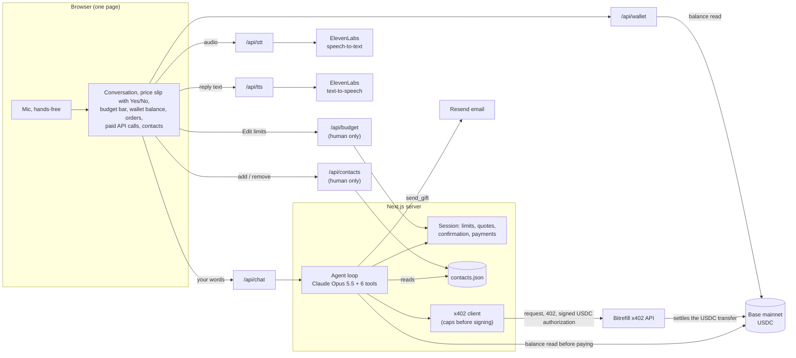
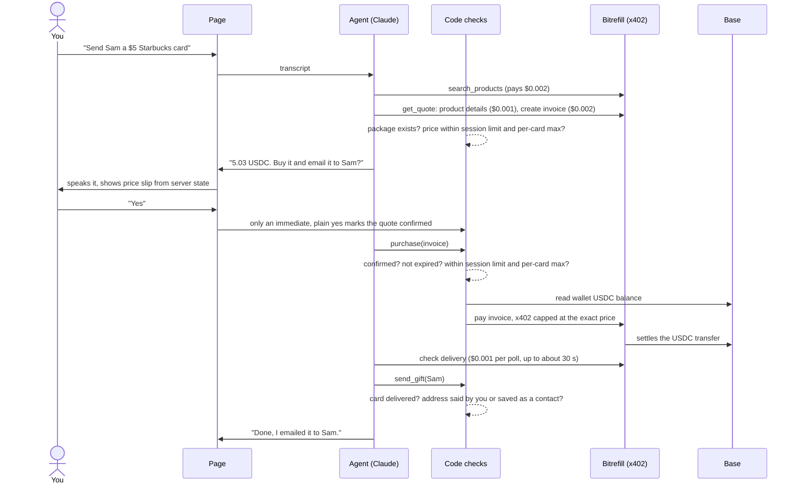

# Gift agent

A voice agent that buys real gift cards with USDC and emails them to your friends. You talk to it, it finds the card, tells you the exact price, and pays on Base over [x402](https://x402.org) only after you say "yes".

> "Send Sam a $5 Starbucks card, tell them happy birthday."
> "A $5 Starbucks USA card comes to 5.03 USDC. Should I buy it and email it to Sam?"
> "Yes."

Every API call the agent makes to Bitrefill is itself paid per request in USDC, and every limit that protects your money is enforced in code, not in the prompt.

Built for the University Blockchain Conference 2026, Agentic Payments and AI track (plus the ElevenLabs bounty).

## Proof it works

A real $5 Starbucks gift card bought on Base mainnet by the purchase script (`npm run spike`), which uses the same x402 client and caps as the agent: [payment on Basescan](https://basescan.org/tx/0x132fc3b5f2b2fcc76ab1962ad842ec5ad46d2020e4c853079e13c529d0199e4c). The card was delivered about 5 seconds after payment.

## Using it

Open the page, tap the mic once and talk. The mic stays on: when you pause, it sends what you said, speaks the reply, then listens again. Tap the mic to stop. You can also type.

Things to say:

- "Get me a $5 Starbucks card."
- "Send Sam a $10 Amazon card, tell them happy birthday." (Sam must be a saved contact, or say the address: "sam at gmail dot com".)
- "How much can I still spend?"
- "Did my last order arrive?"

What's on the page:

| Control | What it does |
|---|---|
| Price slip | Appears when a quote is waiting. Shows the exact USDC price from the server, not from the model. Say "yes" or press **Yes, buy it**; say or press anything else and the quote is cancelled. |
| Budget bar and **Edit limits** | How much of the session limit is left. Edit limits sets the session limit ($0 to $100) and the max per card ($0 to $15). Only you can change these; the agent can't. |
| Wallet | The wallet's USDC balance read live from Base, linked to Basescan. |
| Orders | Each purchase with its status, the gift card link or code once delivered, who it was emailed to, and the payment on Basescan. |
| Paid API calls | Each x402 fee the agent paid Bitrefill, with its Basescan transaction, plus Claude usage against its cap. |
| Contacts | Save a name and email so you can say "send Alex a card". Stored in `contacts.json` on the server, which is gitignored. |
| Test mode badge | Shown when `DRY_RUN=1`: everything runs except paying for the card. |

## Architecture



The server wallet only signs. Bitrefill submits each transfer on-chain and pays the gas, so the wallet needs USDC but no ETH.

| Piece | File |
|---|---|
| x402 client, caps, fee log, request logging | [src/bitrefill.ts](src/bitrefill.ts) |
| Agent loop, tools, session, limits, gift email | [src/agent.ts](src/agent.ts) |
| Contacts storage and validation | [src/contacts.ts](src/contacts.ts) |
| The one shared in-memory session | [src/server-session.ts](src/server-session.ts) |
| Page | [app/page.tsx](app/page.tsx) |
| API routes: chat, stt, tts, budget, wallet, contacts | [app/api/](app/api/) |
| Free self-check (12 checks) | [src/check.ts](src/check.ts) |

## The agent's decision loop

Each user turn runs a tool loop on Claude (Messages API, up to 6 model calls). The model chooses the tools; the code decides whether money moves.



The system prompt keeps the agent on gift cards and tells it to state product and price before asking. Nothing that protects money relies on the prompt. If the model calls `purchase` without a yes, the code refuses.

### Tools

The model can call these six tools. It has no tool that changes a limit, a contact or the wallet.

| Tool | Input | What it does | Costs | Refuses when |
|---|---|---|---|---|
| `search_products` | `query`, `country` (e.g. "US") | Finds gift cards; returns name, slug, in stock | $0.002 | |
| `get_quote` | `slug`, `value` (exact package, e.g. "5") | Product details, then creates an invoice; returns the total USDC price and marks it waiting for your yes | $0.003 | The value doesn't exist (lists the ones that do), or it's over the session limit or per-card max |
| `purchase` | `invoice_id` | Pays the invoice over x402, then checks delivery; returns the payment and the card link or code | Card price, plus $0.001 per delivery check | No yes to this quote, quote expired, over a limit, or the wallet holds too little USDC |
| `check_order` | `invoice_id` | Delivery status, with the card link or code once delivered | $0.001 | |
| `check_funds` | none | Live wallet USDC on Base, session limit, what's left, per-card max | Free (chain read) | |
| `send_gift` | `invoice_id`, `recipient_email`, `message` | Emails the card link or code with your note (a marked test email in test mode) | Free | No such purchase, card not delivered yet, or the address isn't one you said or saved as a contact |

## Safety limits

All enforced in code. `npm run check` tests them without moving funds.

| Limit | Default | How it's enforced |
|---|---|---|
| Human confirmation | Every purchase | `get_quote` marks the invoice pending. It's confirmed only if your very next message is made of affirmative words alone: yes, yeah, yep, yup, sure, confirm, do it, go ahead, buy it, ok, please ("Yes, please." counts). Any other message cancels the quote, so "yes but make it $10", a late yes or "I pre-approve" never pay. One yes pays once. |
| Per-card max | $10, editable up to $15 | You set it with **Edit limits**; the agent has no tool to change it. Above it sits a $15 hard ceiling in code, also enforced by the x402 client's spend control before anything is signed. |
| Exact-price payment | Invoice price | The pay call's x402 cap equals the quoted price, so a 402 asking for more is refused before signing. |
| Session spend limit | $15 | Set by you with **Edit limits** ($0 to $100). The agent has no tool to change it. Budget is reserved before paying, so a failed payment can't be retried past it. |
| Wallet balance | On-chain | `purchase` reads the wallet's USDC on Base and refuses if it can't cover the price. |
| Per-request fee cap | $0.05 | Every other x402 call is capped far above Bitrefill's $0.001 to $0.002 fees and far below anything harmful. |
| Host and network allowlist | api.bitrefill.com, Base | Off-host URLs (including from Bitrefill's `next_step`) are refused; the x402 client only registers Base (`eip155:8453`). |
| Recipient allowlist | Your words and contacts | `send_gift` only emails an address you said or typed ("alex at gmail dot com" counts) or saved under Contacts. |
| Exact package | Must exist | Asking for a value that doesn't exist is refused instead of quietly buying another. |
| Quote expiry | 30 min | Expired quotes can't be paid. |
| One turn at a time | Always | The server rejects a second request while one runs, so double-clicking "yes" can't race. |
| Claude spend cap | $1 per session | Estimated from token usage; the agent stops calling Claude after it. Also: 300-character messages, 6 model calls per turn, 2,048 output tokens. |
| Secrets in logs | Redacted | Every request and response is logged to `logs/`, with redemption codes and tokens redacted. |
| Test mode | `DRY_RUN=1` | Every check runs; the card itself is never paid (fees only). |

## How the x402 + Bitrefill flow works

1. The agent calls a Bitrefill route such as `GET /x402/gift-cards/search`.
2. Bitrefill answers **HTTP 402** with payment requirements: the amount, the payee, and options on several networks.
3. The official `@x402/fetch` client takes the Base USDC option (the only network we register), checks the amount against our cap, signs an **EIP-3009** USDC transfer authorization with the server wallet, and retries with the payment header.
4. Bitrefill settles the transfer on Base and returns the data, plus a `payment-response` header with the transaction hash.
5. A purchase is the same pattern: `POST /x402/invoice/create` returns an invoice and price, and `POST /x402/invoice/pay` is a 402 for exactly that price.
6. The agent follows Bitrefill's `next_step` URLs between steps rather than hard-coding the flow, with its own parameters and the host allowlist applied.

| Route | Fee |
|---|---|
| search | $0.002 |
| product details | $0.001 |
| create invoice | $0.002 |
| order status | $0.001 |
| pay invoice | the card price |

## Setup

Requires Node 20.9 or later.

```bash
npm install
cp .env.example .env   # then fill it in
npm run check          # free self-check, moves no funds
DRY_RUN=1 npm run dev  # http://localhost:3000, test mode
```

Required in `.env`:

- `AGENT_PRIVATE_KEY`: a **burner** wallet holding a little USDC on Base (about $20). No ETH needed.
- `ANTHROPIC_API_KEY`: Claude API key.

Optional:

- `ELEVENLABS_API_KEY`, with Speech to Text and Text to Speech permissions. Without it, type instead of talking.
- `RESEND_API_KEY` for gift emails. Without it, everything but emailing works. Without a verified domain, Resend only delivers to your own Resend account email.

Test mode still spends real USDC on fees (about half a cent per quote), because Bitrefill's x402 API runs on mainnet only.

Optional settings are documented in [.env.example](.env.example). For real purchases, run without `DRY_RUN` (`npm run build && npm start`).

Other commands:

- `npm run chat`: the agent in the terminal.
- `npm run spike -- starbucks 5 US --dry`: the raw purchase flow, stopping before payment.

Run it on your own machine or a long-running server (Railway, Render, Fly.io). Serverless hosts don't fit, because the session lives in memory and a purchase can take up to 40 seconds.

## Known limits and what's next

- **No auth.** Anyone who can reach the page uses one shared session and wallet. Next: sign-in and per-user budgets in a database.
- **The private key sits on the server.** The code caps are only as strong as the server. Next: a smart wallet with on-chain spend permissions, so the limits hold even if the server is compromised.
- **Browsing costs fees.** Next: Bitrefill's SIWX sign-in, which makes search, quotes and status free and leaves only the card payment on x402.
- **Failure handling.** A payment that fails before signing still uses up its budget reservation (the safe direction). Paid-but-undelivered orders need a manual follow-up with Bitrefill.
- **Gift email needs a verified domain** to reach anyone other than the Resend account owner.
